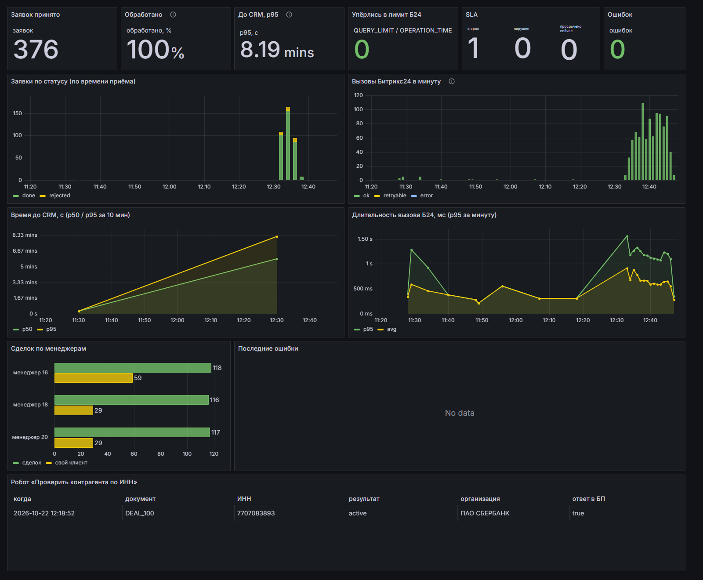
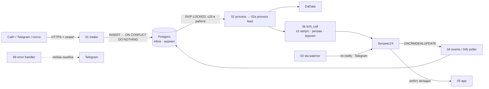
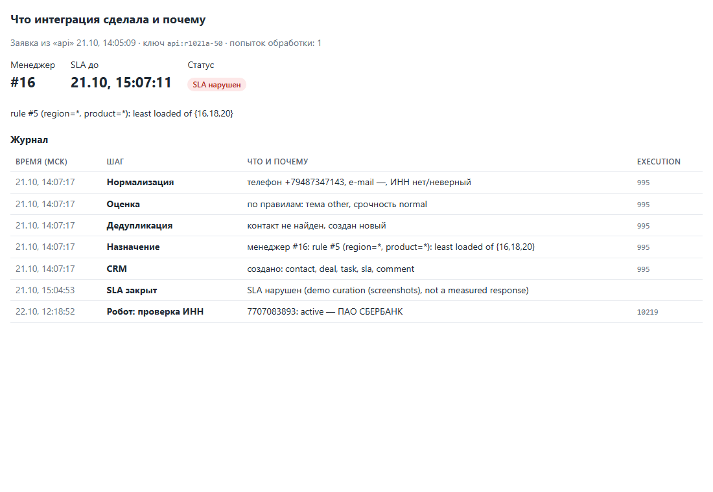

# b24-lead-hub — приём заявок и контроль SLA для Битрикс24 на n8n

Интеграция, которая принимает заявки с сайта, из Telegram и с почты и заводит их в Битрикс24 без дублей.
Она назначает ответственного по правилам, обогащает компанию по ИНН через DaData, ставит задачу и
контролирует время первого ответа. Сделана с упором на надёжность: идемпотентность на каждом шаге, ретраи
с учётом лимитов Битрикс24, одна точка обработки ошибок, откат из git, измеренные цифры.

[](https://github.com/tamarovdenis98-star/b24-lead-hub/actions/workflows/ci.yml)

## Проблема → решение → результат
**Проблема.** B2B-компания получает заявки из трёх каналов. Контакты дублируются, заявки остаются без
ответственного, скорость первого ответа никто не контролирует, менеджеры вручную ищут реквизиты по ИНН.

**Решение.** n8n + Postgres рядом с порталом:
- вход принимает заявку за доли секунды и сразу кладёт её в журнал (`inbox`), повтор того же запроса ничего не создаёт;
- воркер нормализует телефон и e-mail, проверяет ИНН, ищет дубли через `crm.duplicate.findbycomm`, обогащает
  компанию через DaData и выбирает менеджера: «свой клиент → свой менеджер», затем таблица правил, затем наименее загруженный;
- двумя пакетными вызовами создаёт компанию с реквизитами, контакт, сделку, задачу, элемент смарт-процесса
  «Контроль SLA» и комментарий в таймлайне;
- SLA закрывается по событию `ONCRMDEALUPDATE` (и по опросу как страховка), просрочки эскалируются менеджеру и РОПу;
- своё локальное приложение: робот «Проверить контрагента по ИНН» и вкладка «Интеграция» в сделке, где видно,
  что интеграция сделала и почему.

**Результат** (все цифры измерены скриптами на реальном портале, подробности в [docs/results.md](docs/results.md)):

| Что измерено | Результат |
|---|---|
| Нагрузочный прогон: 500 запросов, из них 20 % повторов и 10 % мусора | **0 дублей** сделок, контактов и компаний в CRM |
| Правильность связей в CRM (сделка → контакт/компания, SLA-элемент → сделка) | **350 из 350** |
| Обработано из принятого | **100 %** (350 сделок + 25 отклонённых как непригодные), 0 ошибок |
| Повторы, распознанные на входе | **100 из 100** |
| Упёрлись в лимиты Битрикс24 (`QUERY_LIMIT_EXCEEDED` / `OPERATION_TIME_LIMIT`) | **0** при пике 110 вызовов/мин |
| От заявки до сделки, задачи и SLA в CRM, без нагрузки | **5–15 с** |
| То же под пачкой 500 заявок за 5 минут (1 vCPU) | p95 492 с — это ожидание в очереди, см. ниже |
| Робот «Проверить контрагента по ИНН» | ответ в бизнес-процесс за **2 с** |
| Откат всех workflow на прошлую версию из git | **45 с** (возврат вперёд 43 с) |
| Тесты | **124** (JavaScript и SQL из самих workflow, правила надёжности), зелёный CI |

Почему время до CRM под нагрузкой большое: заявки приходили со скоростью 1,3 в секунду, а обработка
идёт со скоростью 0,46 в секунду (1 vCPU, общий с другими сервисами). Битрикс24 при этом использовался на 1,2 вызова в секунду
из разрешённых 2. Узкое место — CPU сервера, а не лимит портала. Во время прогона обработку пришлось
выключить на 2,5 минуты, когда n8n подошёл к лимиту памяти; после этого появилось ограничение числа
одновременно обрабатываемых заявок ([results](docs/results.md)).

> **Расчёт с допущениями, не измерение.** Если менеджер тратит ~3 мин на заявку на поиск дублей, реквизитов
> по ИНН и заведение сделки, то при 50 заявках в день это ~2,5 ч работы в день. Интеграция делает это за секунды и не
> пропускает просроченные ответы.



## Как устроено

Подробно: [docs/architecture.md](docs/architecture.md). Почему так, а не иначе: [docs/adr](docs/adr).



## Три вопроса надёжности
**1. Что будет, если запрос придёт дважды?**
Ничего нового. На входе `idempotency_key` (`Idempotency-Key` или `source:external_id`) уникален в `inbox`,
и 30 одинаковых параллельных запросов дают одну строку (тест и прогон). В CRM каждая сделка помечена
`ORIGIN_ID = ключ заявки`. Если обработка упала посередине, повтор находит свою сделку и дозаводит только
недостающее: задачу, SLA, комментарий ([ADR 0005](docs/adr/0005-crm-side-idempotency.md)). Два параллельных
воркера не создадут один контакт дважды: клиент блокируется по телефону, e-mail и ИНН ([ADR 0006](docs/adr/0006-workers-and-client-locks.md)).

**2. Куда идёт ошибка?**
Все workflow подключены к `99 error handler`: ошибка пишется в таблицу `errors` и приходит в Telegram со
ссылкой на конкретное выполнение. Ошибка внутри библиотеки даёт один алерт от вызывающего workflow со ссылкой
на дочернее выполнение. Шторм из одной ноды глушится после 3 алертов за 5 минут, но продолжает логироваться.
Если упал Postgres, алерт всё равно уходит ([ADR 0004](docs/adr/0004-alerting.md)). Лимиты и ошибки Битрикс24,
в том числе в теле ответа с HTTP 200, разбирает одна обёртка `lib b24_call`: экспоненциальный backoff,
ожидание до `operating_reset_at`, журнал каждой попытки ([ADR 0003](docs/adr/0003-global-throttle.md)).
Неудачная заявка повторяется через 1/2/4/8 минут, после 5 попыток становится окончательной.

**3. Как откатиться за 5 минут?**
`./scripts/rollback.sh <commit>` разворачивает все workflow из нужной ревизии git. Измерено: 45 секунд.
Миграции только добавляют, поэтому старые workflow работают на новой схеме. Если CRM портится данными,
выключается `02 process`: приём продолжается в `inbox`, ничего не теряется. Эскалации выключаются одной
настройкой (`sla_watch_dry_run`). Подробно: [docs/runbook.md](docs/runbook.md).

## Как я использовал AI при разработке
Проект сделан в паре с Claude Code (Anthropic). Распределение ролей:
- **я** поставил задачу и требования к надёжности (бриф), принимал решения на каждом этапе (что делать с демо-данными, лимит эскалаций,
  Grafana вместо Metabase из-за памяти VPS), давал доступы, работал в интерфейсе портала и проверял результат;
- **AI** проектировал и писал workflow, SQL, скрипты и тесты, разворачивал через API n8n и проверял всё живыми
  запросами к порталу, фиксируя id выполнений и цифры.

Что AI сделал неправильно и как это нашлось: это отдельная причина, почему здесь так много проверок.
- Параметры пакетного вызова проходили через `jsonb`, который переставляет ключи, и сделки создавались раньше
  контактов: у 319 из 350 сделок первого прогона был неверный контакт. Нашлось проверкой связей, которой изначально
  не было в прогоне. Теперь она там есть, во втором прогоне 350 из 350.
- Пустой тик воркера запускал обработку с пустыми данными, и в Telegram пошли ложные алерты.
- n8n отдаёт HTML вебхуков с `CSP: sandbox`, поэтому `installFinish` приложения не доходил до портала. Нашлось по `INSTALLED: false` в `app.info`.
- При большой очереди тики воркера накладывались, и n8n подошёл к лимиту памяти. Нашлось мониторингом во время прогона.

Правило проекта: в README только измеренные цифры, каждый workflow прогнан реальными запросами.

## Быстрый старт
```bash
git clone https://github.com/tamarovdenis98-star/b24-lead-hub && cd b24-lead-hub
cp .env.example .env                      # портал, вебхук Б24, секреты
docker compose up -d                      # Postgres + миграции
./scripts/seed_config.sh                  # вебхук, chat_id, менеджеры и демо-роутинг -> Postgres
python scripts/b24_setup.py > sql/seed/portal_settings.sql && ./scripts/seed_config.sh   # смарт-процесс «Контроль SLA»
set -a; . ./.env; set +a
python scripts/n8n_sync.py credentials    # n8n Credentials из .env
python scripts/n8n_sync.py deploy         # все workflow: создать/обновить, теги, активировать
python scripts/post_demo_lead.py          # демо-заявка (второй запуск вернёт duplicate: true)
docker compose --profile dashboard up -d grafana   # необязательно: дашборд на 127.0.0.1:3000
```
Проверки: `pip install -r requirements-dev.txt && pytest` (тесты на Postgres запускаются при заданной переменной `TEST_PG_DSN`).
Нагрузочный прогон: `python scripts/replay_load.py` (переменные окружения описаны в шапке скрипта). Уборка демо-данных: `python scripts/cleanup_demo.py`.

## Что где лежит
| Путь | Что |
|---|---|
| `workflows/` | экспорт n8n без секретов; разворачивается `scripts/n8n_sync.py` |
| `sql/` | миграции; `sql/seed/` — демо-роутинг |
| `scripts/` | деплой и экспорт, нагрузочный прогон, проверка связей CRM, настройка портала, уборка, откат |
| `tests/` | pytest: JS из workflow под Node, SQL на Postgres, правила надёжности для workflow |
| `grafana/` | дашборд и источник данных (только чтение) |
| `docs/` | [architecture](docs/architecture.md), [security](docs/security.md), [runbook](docs/runbook.md), [results](docs/results.md), [ADR](docs/adr) |
| `demo/` | скриншоты и [сценарий демо-видео](demo/SCRIPT.md) |

## Ограничения
SLA считается в календарном времени, без рабочих часов. Скоринг заявок пока на правилах (LLM-скоринг
с фолбэком появится вместе с ключами LLM). Каналы Telegram и почта подключаются тонкими адаптерами
к тому же `01 intake` и в этом репозитории не реализованы. Демо-портал — пробный Битрикс24, VPS — 1 vCPU / 2 ГБ.
