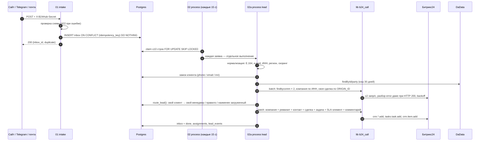
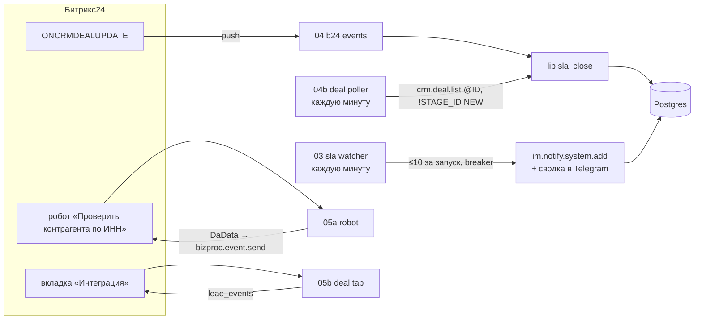

# Архитектура

## Поток заявки

После этого SLA ведут три независимых механизма:

## Компоненты

| Workflow | Триггер | Что делает |
|---|---|---|
| `01 intake` | webhook | авторизация заголовком, проверка схемы, вставка в `inbox` без дублей, ответ сразу |
| `02 process` | каждые 15 с | забирает пачку с `SKIP LOCKED`, неудача → backoff 1/2/4/8 мин, 5 попыток |
| `02a process lead` | sub-workflow | вся обработка одной заявки, см. схему выше |
| `03 sla watcher` | каждую минуту | эскалация просроченных SLA: dry-run, лимит, предохранитель ([ADR 0008](adr/0008-sla-watcher-safety.md)) |
| `04 b24 events` | webhook | `ONCRMDEALUPDATE` → проверка токена → `crm.deal.get` → `lib sla_close` |
| `04b deal poller` | каждую минуту | страховка от потерянных событий ([ADR 0009](adr/0009-deal-events-and-poller.md)) |
| `05 app install` / `05 app` / `05a` / `05b` / `05c` | webhooks | локальное приложение: установка, страница, робот, вкладка, удаление ([ADR 0010](adr/0010-local-app.md)) |
| `lib b24_call` | sub-workflow | единственная дорога в Битрикс24: троттлинг, разбор ошибок, backoff, журнал, OAuth ([ADR 0003](adr/0003-global-throttle.md)) |
| `lib b24_app_token` | sub-workflow | обновление OAuth по `expired_token`, один обновляющий одновременно |
| `lib sla_close` | sub-workflow | единственное место закрытия SLA, статус по `MOVED_TIME` |
| `lib app_setup` | sub-workflow | регистрация событий, робота и вкладки для установленного приложения |
| `99 error handler` | Error Trigger | `errors` + один алерт в Telegram на инцидент ([ADR 0004](adr/0004-alerting.md)) |
| `90 test harness`, `91 b24 mock` | webhook | тестовый вход в lib и детерминированный имитатор отказов Битрикс24 |

## Данные (Postgres, `sql/`)

| Таблица | Назначение |
|---|---|
| `inbox` | каждая принятая заявка ровно один раз (`idempotency_key UNIQUE`), статус, попытки, результат |
| `intake_rejects` | что отклонила схема и почему |
| `assignments` | менеджер, правило и причина; сделка, SLA-элемент, дедлайн и статус SLA |
| `lead_events` | журнал «что сделано и почему» по шагам (источник вкладки в сделке) |
| `client_locks` | сериализация обработки одного клиента параллельными воркерами ([ADR 0006](adr/0006-workers-and-client-locks.md)) |
| `managers`, `routing_rules` | демо-таблица маршрутизации; функция `route_lead()` |
| `b24_call_log` | каждая попытка вызова Б24: метод, статус, ошибка, длительность, `time.operating` |
| `errors`, `sla_watch_runs`, `robot_runs` | ошибки, запуски watcher'а, запуски робота |
| `b24_auth`, `b24_app`, `settings` | вебхук и OAuth-токены приложения, параметры окружения (недоступны роли дашборда) |
| `dadata_cache`, `rate_limiter` | кэш DaData, общий слот троттлинга |

## Ключевые решения
- **Идемпотентность в два слоя**: `inbox` для запроса и `ORIGIN_ID` для записи в CRM. Повтор после частичного сбоя дозаводит недостающее, а не создаёт дубль ([ADR 0005](adr/0005-crm-side-idempotency.md)).
- **Синхронный путь без тяжёлой логики**: intake только пишет в `inbox`. Если Битрикс24 недоступен, заявки копятся и не теряются.
- **Секреты не в workflow**: вебхук и токены хранятся в Postgres и n8n Credentials, экспорт проверяется в CI ([ADR 0002](adr/0002-b24-auth-in-postgres.md)).
- **Одна дорога в Битрикс24** (`lib b24_call`), так что лимиты и ошибки обрабатываются в одном месте. Это проверяет тест `test_portal_is_called_only_through_the_wrapper`.
